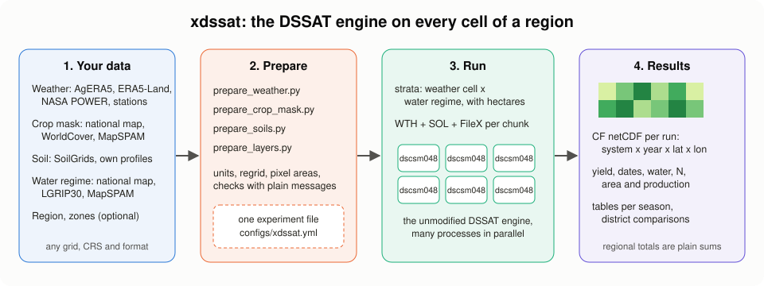
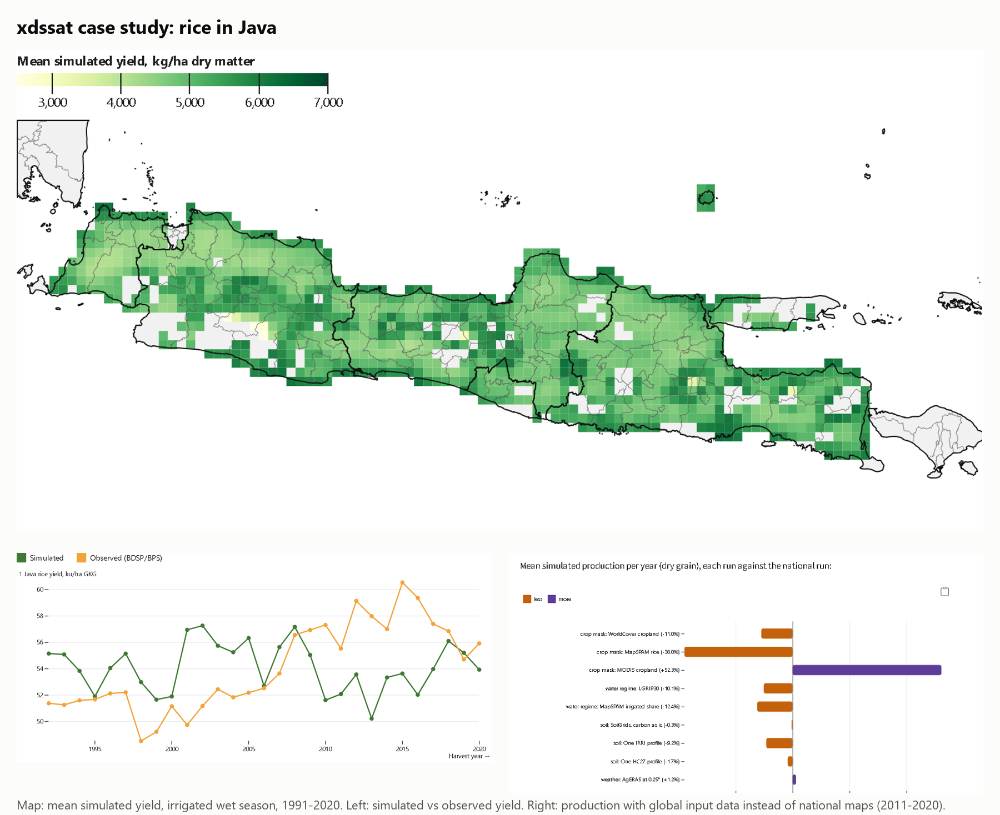

<p align="center">
  <picture>
    <source media="(prefers-color-scheme: dark)" srcset="docs/assets/logo/logo-dark-256.png">
    
  </picture>
</p>

# xdssat

Gridded crop simulation with the DSSAT-CSM engine, driven from Python and xarray.

xdssat is a bridge between DSSAT and Python. It does not reimplement DSSAT: it writes the engine's own input
files for every grid cell and season, runs the unmodified `dscsm048` engine in parallel, and collects the
results into one CF netCDF file. The inputs (weather, crop mask, soil, water regime) come from your own data or
from global datasets such as AgERA5, ERA5-Land, NASA POWER, SoilGrids, WorldCover and LGRIP30; see
[Input data](https://bennyistanto.github.io/xdssat/xdssat/data.html).

**Documentation: [bennyistanto.github.io/xdssat](https://bennyistanto.github.io/xdssat/)**, with the getting-started
guide, a main case study (rice in Java, Indonesia), five further case studies (maize after rice in East
Java, millet in Niger, maize in Kenya, rice in the Mekong Delta and in northern Luzon), and a six-module DSSAT
training with notebooks.





*Case study, rice in Java: mean simulated yield of irrigated wet-season rice per 0.1° cell (1991-2020), simulated against observed (BDSP/BPS) yield for the whole of Java, and the change in simulated production when global datasets replace the national inputs (2011-2020, see [Alternative input data](https://bennyistanto.github.io/xdssat/java/alternatives.html)).*

## What is in this repository

| Folder | Contents |
|---|---|
| `src/` | The Python modules: weather, soil and experiment files, the parallel runner, netCDF output, gridded inputs |
| `scripts/` | Setup checks, building the engine, preparing inputs, running an area (`run_aoi.py`) |
| `configs/` | Experiment files: `rice-java.yml` (the reference, every setting explained), `rice-java-all-options.yml` (every option in use), `maize-example.yml`, `cases/` (one per case study), and your own `xdssat.yml` (not committed). See [configs/README.md](configs/README.md) |
| `templates/` | Template experiments, written by `scripts/make_templates.py` from DSSAT's own experiments: `XDRI8601.RIX` (rice, flooded and rainfed), `XDRW8601.RIX` (the same with two more percolation rates), `XDMZ8201.MZX` (maize), `XDML8601.MLX` (pearl millet), `XDRM8601.SQX` (rice then maize, a crop sequence) |
| `example-inputs/` | Five small areas with their inputs already prepared from public data, each with a ready-to-run `experiment.yml` |
| `tests/` | `pytest` suite; tests marked `engine` run the real engine |
| `notebooks/` | Engine check notebook |
| `docs/` | The documentation site (Quarto), including the training notebooks |
| `spikes/` | Small experiments behind numbers quoted in the docs |

## Quick start

Every setting of a run (machine paths, area, cultivars, N rates, water regimes, planting
calendar, scenarios such as CO2 or warming, years) lives in **one file**. Nobody has to edit
Python.

```bash
cp configs/rice-java.yml configs/xdssat.yml   # then fill in its paths section; every setting is explained
python scripts/check_setup.py      # checks the file and the machine, says what to fix and where
python scripts/build_engine.py     # if DSSAT is not installed
python scripts/run_aoi.py          # runs every cultivar x N rate x scenario of configs/xdssat.yml
```

To try it before preparing any data, run one of the five examples, whose inputs ship in
`example-inputs/` (engine, work and cache folders as `XDSSAT_*` variables):
`python scripts/run_aoi.py --config example-inputs/java_rice/experiment.yml`.

xdssat has no built-in folders: each computer sets its own in `configs/xdssat.yml` (or with
`XDSSAT_*` environment variables). A run reads its data (weather, crop mask, soil, water regime,
region, zones) as prepared datasets in a standard form, whatever the source;
[Input data](https://bennyistanto.github.io/xdssat/xdssat/data.html) lists what each must be and
how to prepare it, and `python scripts/register_inputs.py --list` shows what you have. For further
studies keep one file per study in `configs/`,
for example `configs/co2-java.yml`, and run it with
`python scripts/run_aoi.py --config configs/co2-java.yml`. Command-line flags
(`--sample 30 --years 2015 2016` for a quick test) win over the file. The tests:
`python -m pytest tests`.

The full setup, from an empty machine to a run, is in the
[getting-started guide](https://bennyistanto.github.io/xdssat/xdssat/getting-started.html)
([docs/xdssat/getting-started.md](docs/xdssat/getting-started.md)).

## Not an official DSSAT product, and experimental

xdssat is an independent project, not developed or endorsed by the DSSAT Foundation. It is also experimental:
it is tested on one main case study (rice in Java), five further case studies (maize after rice in East Java,
millet in Niger, maize in Kenya, rice in the Mekong Delta and in northern Luzon), short runs in Sumatra, and the training
examples. Use it at your own risk, and
check its results against your own data before relying on them. If you publish results made
with it, please cite DSSAT as the DSSAT Foundation asks; see
[Acknowledgements and how to cite](https://bennyistanto.github.io/xdssat/about/acknowledgements.html).

## Licence

MPL-2.0. The DSSAT-CSM engine is BSD-3 (DSSAT Foundation) and is built from its own repository; xdssat does not
include it.

## Contact

Benny Istanto, [benny.istan.to](https://benny.istan.to). Questions and problems:
[issue tracker](https://github.com/bennyistanto/xdssat/issues).
