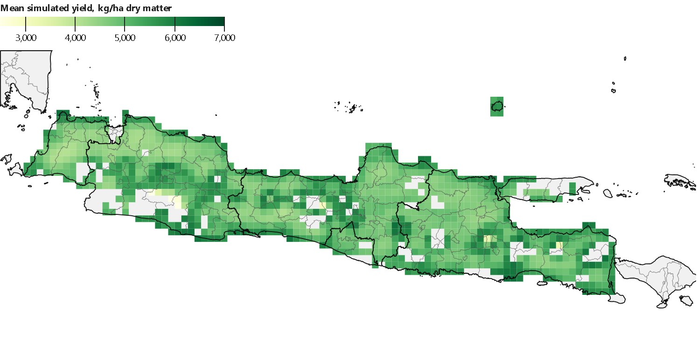
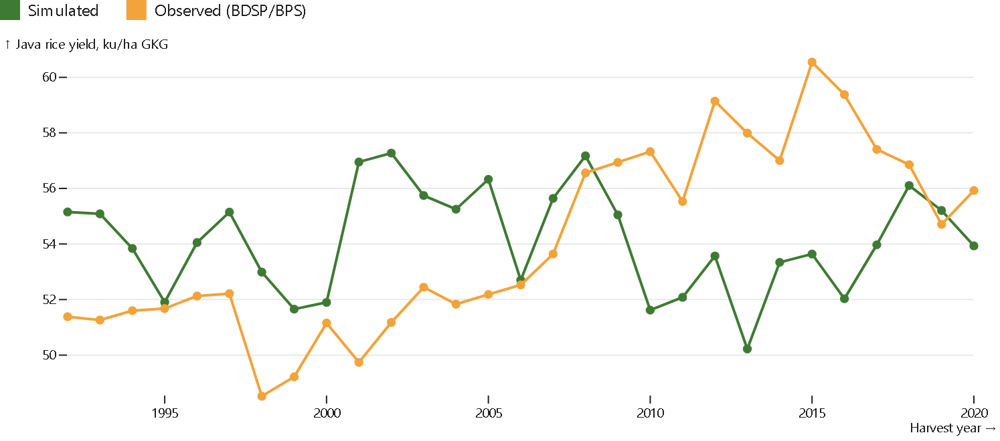

# xdssat

Gridded crop simulation with the DSSAT-CSM engine, driven from Python and xarray.

xdssat is a bridge between DSSAT and Python. It does not reimplement DSSAT: it writes the engine's own input
files for every grid cell and season, runs the unmodified `dscsm048` engine in parallel, and collects the
results into one CF netCDF file. Weather comes from AgERA5 (0.1°), soils from SoilGrids 2.0.

**Documentation: [bennyistanto.github.io/xdssat](https://bennyistanto.github.io/xdssat/)**, with the getting-started
guide, a case study (rice in Java, Indonesia) and a six-module DSSAT training with notebooks.



*Case study: mean simulated yield of irrigated wet-season rice per 0.1° cell of Java, 1991-2020.*



*Simulated against observed (BDSP/BPS) rice yield for the whole of Java.*

## What is in this repository

| Folder | Contents |
|---|---|
| `src/` | The Python modules: weather, soil and experiment files, the parallel runner, netCDF output, gridded inputs |
| `scripts/` | Setup checks, building the engine, preparing inputs, running an area (`run_aoi.py`) |
| `templates/` | Template experiment: `XDRI8601.RIX`, IRRI rice with irrigated and rainfed water levels |
| `tests/` | `pytest` suite; tests marked `engine` run the real engine |
| `notebooks/` | Engine check notebook |
| `docs/` | The documentation site (Quarto), including the training notebooks |
| `spikes/` | Small experiments behind numbers quoted in the docs |

## Quick start

```bash
python scripts/check_setup.py      # what is missing, and the command that fixes it
python scripts/build_engine.py     # if DSSAT is not installed
python -m pytest tests
```

The full setup, from an empty machine to a run, is in the
[getting-started guide](https://bennyistanto.github.io/xdssat/getting-started.html)
([docs/getting-started.md](docs/getting-started.md)).

## Not an official DSSAT product

xdssat is an independent project, not developed or endorsed by the DSSAT Foundation. If you publish results made
with it, please cite DSSAT as the DSSAT Foundation asks; see
[Acknowledgements and how to cite](https://bennyistanto.github.io/xdssat/acknowledgements.html).

## Licence

MPL-2.0. The DSSAT-CSM engine is BSD-3 (DSSAT Foundation) and is built from its own repository; xdssat does not
include it.

## Contact

Benny Istanto, [benny.istan.to](https://benny.istan.to). Questions and problems:
[issue tracker](https://github.com/bennyistanto/xdssat/issues).
