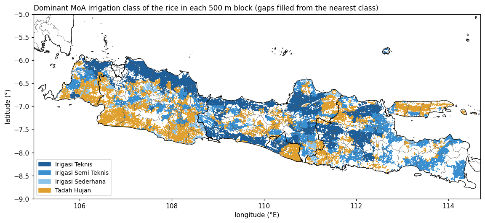

```{ojs}
import {withDownload, adminMarks, cellFeatures, fmt} from "../assets/js/dl.js"
summary = FileAttachment("data/summary.json").json()
cells = FileAttachment("data/grid_cells.csv").csv({typed: true})
districtsGeo = FileAttachment("data/districts.geojson").json()
outline = FileAttachment("data/java_outline.geojson").json()
provinces = FileAttachment("data/provinces.geojson").json()
districts = FileAttachment("data/districts.csv").csv({typed: true})
irrClasses = FileAttachment("data/java_irrigation_classes.csv").csv({typed: true})
obsProv = FileAttachment("data/obs_province_years.csv").csv({typed: true})
obsMeans = FileAttachment("data/obs_district_means.csv").csv({typed: true})
flagsJava = FileAttachment("data/obs_flags_java.csv").csv({typed: true})
flagsAll = FileAttachment("data/obs_flags_all.csv").csv({typed: true})
cultivars = FileAttachment("data/cultivars.csv").csv()
sens = FileAttachment("data/sensitivity.csv").csv({typed: true})
cur = summary.current
mapW = Math.min(width, 960)
```

## The datasets

| Dataset | Provider and reference | Native format | Used for |
|---|---|---|---|
| AgERA5 daily agrometeorological indicators | Copernicus Climate Change Service [@agera5] | netCDF, 0.1°, daily, global; one file per variable and year | Weather of every cell: SRAD, TMAX, TMIN, RAIN, DEWP, WIND (`src/agera5.py`) |
| SoilGrids 2.0 | ISRIC [@poggio2021] | GeoTIFF/VRT, 250 m, Interrupted Goode Homolosine, six depths, `mean` layers | Texture, organic carbon, bulk density, pH, CEC, N: one soil profile per cell (`src/soils.py`) |
| WISE profiles in DSSAT's `WI.SOL` | @romero2012 | DSSAT `.SOL` text | Scaling SoilGrids organic carbon; checking the root-growth rule |
| Rice fields (*luas baku sawah*) 2024 | ATR/BPN | GeoPackage, 1,430,241 polygons, 7,384,340 ha | Where rice is, as a share of each 100 m pixel (`src/rasters.py`) |
| Java rice by irrigation type | Ministry of Agriculture (MoA) | Two shapefiles (irrigated, rain-fed), attributes `*_09` | Water regime: classes 1-3 irrigated, 4 rain-fed |
| Agro-ecological zones | BBSDLP | Shapefile, island groups (`KML_FOLDER`) and 57 zones (`SIMBOL`) | Selecting Java; zone calendars in `by_zone` mode |
| Soil map 1:50,000 | BBSDLP | Shapefile, class names only (`JNTNH1-3`) | Rasterised for reference; no physical properties |
| Province (admin1) and district (admin2) boundaries | BPS codes (`a1bps`, `a2bps`), files `idn_bnd_adm1.shp`, `idn_bnd_adm2.shp` | Shapefile | Rice area per district; province and district lines on every map |
| District rice statistics | MoA BDSP portal, source named there: BPS [@bdsp] | HTML tables, scraped | Observed harvested area, production and yield, 1986-2025 |
| Rice experiment IRMZ8601 | IRRI, Munoz 1986, in `dssat-csm-data` (BSD-3) | DSSAT FileX `.RIX` | Template management: transplanting, flood, split N |

::: {.source-note}
Counts and file details: `temp/inputs-detail.md` and the module docstrings of `src/agera5.py`,
`src/soils.py`, `src/rasters.py`; `scripts/prepare_rasters.py` lists the input paths. The provenance of the
boundary files beyond their BPS codes is not documented in this repository. On every map, province lines
(bold) and district lines (thin) are cut to the Java area of interest plus 1° and simplified by 0.002° by
`export_data.py`, for location only.
:::

## The area of interest: Java

Java is selected by the island group "Jawa" of the agro-ecological zone map, burned onto the same 100 m grid as
the rice fields. Every 100 m pixel with rice belongs to exactly one 0.1° AgERA5 cell (the cell that holds its
centre), so the cell totals add up to the raster total. For the current run that is
**${fmt.int(cur.ha)} ha of rice in ${fmt.int(cur.cells)} cells**.

```{ojs}
viewof haVar = Inputs.select(new Map([["Rice area, all (ha)", "ha"], ["Irrigated rice (ha)", "ha_irrigated"], ["Rain-fed rice (ha)", "ha_rainfed"], ["Irrigated share", "irr_share"]]), {label: "Show"})
```

```{ojs}
withDownload(Plot.plot({
  width: mapW, height: Math.round(mapW * 0.42),
  projection: {type: "mercator", domain: outline},
  color: haVar === "irr_share"
    ? {type: "linear", scheme: "BuGn", domain: [0, 1], legend: true, label: "Irrigated share of the cell's rice", tickFormat: ".0%"}
    : {type: "sqrt", scheme: "YlGn", legend: true, label: "Rice area in the 0.1° cell, ha"},
  marks: [
    Plot.geo(provinces, {fill: "#f1f1f1", clip: true}),
    Plot.geo(cellFeatures(cells).features, Plot.centroid({fill: d => d.properties[haVar], title: d => `${d.properties.lat.toFixed(1)}, ${d.properties.lon.toFixed(1)}\n${fmt.int(d.properties.ha)} ha (irrigated ${fmt.int(d.properties.ha_irrigated)}, rain-fed ${fmt.int(d.properties.ha_rainfed)})`, tip: true})),
    ...adminMarks(Plot, provinces, districtsGeo)
  ]
}), `xdssat-java-rice-area-${haVar}`)
```

```{ojs}
provTable = {
  const rows = d3.rollups(districts.filter(d => d.run === summary.current_run), v => ({ha: d3.sum(v, d => d.rice_ha), n: v.length}), d => d.province)
    .map(([province, v]) => ({province, ha: v.ha, districts: v.n})).sort((a, b) => b.ha - a.ha);
  const tot = d3.sum(rows, d => d.ha);
  return Inputs.table(rows.map(d => ({...d, share: d.ha / tot})), {
    columns: ["province", "districts", "ha", "share"],
    header: {province: "Province", districts: "Districts compared", ha: "Rice ha (100 m rasters)", share: "Share"},
    format: {ha: fmt.int, share: d => (d * 100).toFixed(1) + "%"}, rows: 8, layout: "auto"});
}
provTable
```

::: {.source-note}
Rice ha per province: sum over the ${summary.districts[summary.current_run].districts} districts that
`scripts/compare_districts.py` compares (at least 1,000 ha of rice and 5 observed years), from
`idn_adm2_filled.tif`, so a few small districts are missing from the total.
:::

### Rice fields at 100 m

The rasters behind the cells are too large for the browser, so here they are as static images (500 m blocks;
the model uses the 100 m pixels). The grid is ESRI:54034 (World Cylindrical Equal Area), on which every pixel
is 1 ha. Polygons are burned with `all_touched`, so no field is lost however small, and the share of each pixel
under rice comes from a 20 m sub-grid.

{#fig-rice-share}

{#fig-irrigation}

The MoA maps do not cover every ATR/BPN rice field. Pixels without a class take the class of the nearest MoA
pixel; the chart shows how much rice area that concerns.

```{ojs}
withDownload(Plot.plot({
  width: Math.min(width, 760), height: 230, marginLeft: 140,
  x: {label: "Rice area, thousand ha", grid: true},
  y: {label: null},
  color: {legend: true, domain: ["own MoA class", "filled from nearest"], range: ["#2a7f62", "#d9822b"]},
  marks: [
    Plot.barX(irrClasses.flatMap(d => [{cls: d.class, part: "own MoA class", v: d.ha_own / 1000}, {cls: d.class, part: "filled from nearest", v: d.ha_filled / 1000}]),
      {y: "cls", x: "v", fill: "part", tip: true, sort: {y: "-x"}}),
    Plot.text(irrClasses, {y: "class", x: d => d.ha / 1000, text: d => `${(d.share * 100).toFixed(1)}%`, dx: 18})
  ]
}), "xdssat-java-irrigation-classes")
```

::: {.source-note}
Computed by `export_data.py` from `idn_rice.tif` and `idn_irrigation_filled.tif` (band 2 = distance to the
MoA pixel the class came from; 0 = own class), restricted to the island group Jawa. Water regime in the model:
classes 1-3 irrigated, 4 (*tadah hujan*) rain-fed.
:::

### Agro-ecological zones

Each stratum carries the dominant agro-ecological zone (BBSDLP `SIMBOL`) of its cell's rice. The `by_zone`
mode gives each zone one planting calendar.

```{ojs}
withDownload(Plot.plot({
  width: mapW, height: Math.round(mapW * 0.42),
  projection: {type: "mercator", domain: outline},
  color: {type: "ordinal", scheme: "Tableau10", legend: true, label: "Agro-ecological zone"},
  marks: [
    Plot.geo(provinces, {fill: "#f1f1f1", clip: true}),
    Plot.geo(cellFeatures(cells).features, Plot.centroid({fill: d => d.properties.aez_name, title: d => `zone ${d.properties.aez_name}`, tip: true})),
    ...adminMarks(Plot, provinces, districtsGeo)
  ]
}), "xdssat-java-aez")
```

## Weather: AgERA5

AgERA5 is a daily, 0.1° product derived from the ERA5 reanalysis for agricultural use [@agera5]. xdssat
extracts the Indonesia box once into a cache in DSSAT units (int16 with a scale factor of 0.1, the precision
the weather file carries). Days run from midnight to midnight local time, per the source's `long_name`. The
map shows the seasonal means the engine itself reports for each simulated season (`TMINA`, `TMAXA`, `SRADA`,
`PRCP` in `summary.csv`), averaged over 30 years.

```{ojs}
viewof wVar = Inputs.select(new Map([["Mean minimum temperature, °C", "tmina"], ["Mean maximum temperature, °C", "tmaxa"], ["Mean solar radiation, MJ/m²/d", "srada"], ["Season rainfall, mm", "prcp"], ["Season length, days", "len"]]), {label: "Variable"})
viewof wSys = Inputs.radio(new Map([["Wet, irrigated", "wet_irrigated"], ["Wet, rain-fed", "wet_rainfed"], ["Dry, irrigated", "dry_irrigated"]]), {value: "wet_irrigated", label: "Season"})
```

```{ojs}
{
  const col = `${wVar}_${wSys}`;
  const rows = cells.filter(d => d[col] != null && isFinite(d[col]));
  const scheme = wVar === "prcp" ? "Blues" : wVar === "srada" ? "Oranges" : wVar === "len" ? "Viridis" : "RdYlBu";
  return withDownload(Plot.plot({
    width: mapW, height: Math.round(mapW * 0.42),
    projection: {type: "mercator", domain: outline},
    color: {type: "linear", scheme, reverse: wVar.startsWith("tm"), legend: true, label: col},
    marks: [
      Plot.geo(provinces, {fill: "#f1f1f1", clip: true}),
      Plot.geo(cellFeatures(rows).features, Plot.centroid({fill: d => d.properties[col], title: d => `${fmt.d1(d.properties[col])}`, tip: true})),
      ...adminMarks(Plot, provinces, districtsGeo)
    ]
  }), `xdssat-java-${col}`);
}
```

## Soil: SoilGrids 2.0 to DSSAT profiles

Each weather cell gets one soil profile: the rice-area-weighted mean of the SoilGrids properties over the 100 m
rice pixels in the cell, at six depths, converted to DSSAT layer values (method on the
[Scientific method](science.qmd#soil) page). The map shows the top layer (0-5 cm) of the profile that enters
the engine, read back from `java.SOL`.

```{ojs}
viewof soilVar = Inputs.select(new Map([["Organic carbon (scaled), %", "sloc_top"], ["Clay, %", "slcl_top"], ["Silt, %", "slsi_top"], ["Lower limit LL, cm³/cm³", "slll_top"], ["Drained upper limit DUL, cm³/cm³", "sdul_top"], ["Saturation SAT, cm³/cm³", "ssat_top"], ["Bulk density, g/cm³", "sbdm_top"], ["Plant-available water, whole profile, mm", "paw_mm"]]), {label: "Property"})
```

```{ojs}
{
  const rows = cells.filter(d => d[soilVar] != null && isFinite(d[soilVar]));
  return withDownload(Plot.plot({
    width: mapW, height: Math.round(mapW * 0.42),
    projection: {type: "mercator", domain: outline},
    color: {type: "linear", scheme: "BrBG", legend: true, label: soilVar},
    marks: [
      Plot.geo(provinces, {fill: "#f1f1f1", clip: true}),
      Plot.geo(cellFeatures(rows).features, Plot.centroid({fill: d => d.properties[soilVar], title: d => `${d.properties.texture}: ${fmt.d2(d.properties[soilVar])}`, tip: true})),
      ...adminMarks(Plot, provinces, districtsGeo)
    ]
  }), `xdssat-java-soil-${soilVar}`);
}
```

```{ojs}
withDownload(Plot.plot({
  width: Math.min(width, 560), height: 200, marginLeft: 60,
  x: {label: "Cells (top-layer texture class in java.SOL)", grid: true},
  y: {label: null},
  marks: [Plot.barX(cells.filter(d => d.texture), Plot.groupY({x: "count"}, {y: "texture", fill: "#8c6d46", sort: {y: "-x"}, tip: true}))]
}), "xdssat-java-soil-texture")
```

## Observed yields: BDSP district statistics

Harvested area, production and yield per district and year come from the Ministry of Agriculture's BDSP
portal, which names BPS as the source [@bdsp]. `scripts/fetch_bdsp.py` downloads the tables (raw pages kept)
and `scripts/clean_bdsp.py` cleans them, recording every change with its raw value. For Java the cleaned
tables hold ${summary.obs.java_districts} districts and ${fmt.int(summary.obs.district_years_yield)}
district-years with a yield, ${summary.obs.years.join("-")}.

```{ojs}
withDownload(Plot.plot({
  width: Math.min(width, 900), height: 230, marginLeft: 110,
  x: {label: "Year", tickFormat: d => d % 5 === 0 ? String(d) : ""},
  y: {label: null},
  color: {type: "linear", scheme: "Greens", legend: true, label: "Districts with a yield"},
  marks: [Plot.cell(obsProv.filter(d => d.year >= summary.obs.years[0]), {x: "year", y: "province", fill: "districts_yield", inset: 0.5, tip: true})]
}), "xdssat-bdsp-coverage")
```

```{ojs}
withDownload(Plot.plot({
  width: Math.min(width, 900), height: 340, marginLeft: 50,
  x: {label: "Year", tickFormat: d => String(d)},
  y: {label: "Yield, ku/ha GKG (production / harvested area)", grid: true, zero: false},
  color: {legend: true},
  marks: [
    Plot.lineY(obsProv.filter(d => d.yield_p_over_a != null && isFinite(d.yield_p_over_a)), {x: "year", y: "yield_p_over_a", stroke: "province", strokeWidth: 1.5, tip: true}),
    Plot.dot(obsProv.filter(d => d.yield_p_over_a != null && isFinite(d.yield_p_over_a)), {x: "year", y: "yield_p_over_a", fill: "province", r: 2, tip: true})
  ]
}), "xdssat-bdsp-province-yield")
```

::: {.source-note}
Province yield = sum of production / sum of harvested area over the districts that report both, times 10
(t/ha to ku/ha). Gaps are years in which no district of the province reports both values after cleaning.
:::

The cleaning rules and the number of values each one changed (all Indonesia, and Java by province):

```{ojs}
Inputs.table(flagsAll.sort((a, b) => b.n - a.n), {header: {rule: "Cleaning rule", n: "Values changed, Indonesia"}, rows: 12, layout: "auto"})
```

```{ojs}
withDownload(Plot.plot({
  width: Math.min(width, 900), height: 300, marginLeft: 280,
  x: {label: "Values changed, Java", grid: true},
  y: {label: null},
  color: {legend: true},
  marks: [Plot.barX(flagsJava, {y: "rule", x: "n", fill: "province", tip: true, sort: {y: "-x"}})]
}), "xdssat-bdsp-flags-java")
```

## Variety: IR 58 and IR 64

The template experiment is IRRI's IRMZ8601, a transplanted **IR 58** trial (cultivar `IB0012`), which stays
the default. **IR 64** (`IB0015`) is the second cultivar in the template. The coefficients are read from the
engine's own cultivar file (${summary.cultivar_file}):

```{ojs}
html`<table class="table table-sm small-table">
  <thead><tr><th>Coefficient</th><th>IR 58 (IB0012)</th><th>IR 64 (IB0015)</th><th>Definition (RICER048.CUL)</th></tr></thead>
  <tbody>${cultivars.filter(d => d.coefficient !== "name").map(d => html`<tr><td><code>${d.coefficient}</code></td><td>${d.IB0012}</td><td>${d.IB0015}</td><td>${d.definition}</td></tr>`)}</tbody>
</table>`
```

How far do cultivar and nitrogen move the simulated yield? A 40-cell sample (`spikes/n_cultivar_sensitivity.py`)
ran every cultivar and nitrogen rate of the template. After the initial soil nitrogen fix, the crop responds
to fertiliser as it should; before it, it did not.

```{ojs}
viewof sensFile = Inputs.radio(new Map([["After the initial-N fix (soc1)", "soc1"], ["Before the fix (first run)", "first"]]), {value: "soc1", label: "Sample"})
```

```{ojs}
withDownload(Plot.plot({
  width: Math.min(width, 760), height: 340, marginLeft: 55,
  x: {label: "Nitrogen, kg N/ha", ticks: [0, 35, 70, 105, 140]},
  y: {label: "Area-weighted yield, kg/ha dry matter", grid: true, zero: true},
  color: {legend: true},
  symbol: {legend: true},
  marks: [
    Plot.lineY(sens.filter(d => d.tag === sensFile && d.water !== "all"), {x: "n_kg", y: "hwah", stroke: "cultivar", strokeDasharray: d => d.water === "rainfed" ? "5,3" : null, z: d => d.cultivar + d.water, tip: true}),
    Plot.dot(sens.filter(d => d.tag === sensFile && d.water !== "all"), {x: "n_kg", y: "hwah", fill: "cultivar", symbol: "water", r: 4, tip: true, channels: {water: "water", "season, d": "season_days"}})
  ]
}), `xdssat-n-cultivar-${sensFile}`, "Dashed: rain-fed.")
```

::: {.source-note}
`checks/n_cultivar_sensitivity.csv` (before the fix) and `n_cultivar_sensitivity_soc1.csv` (after): 40 cells,
season years 1992-2014, SLPF 1, per_cell calendar; area-weighted by stratum rice ha. IR 64 has a longer
season and is higher at every N rate; neither cultivar nor N alone brings the model down to the observed
level (`HANDOFF.md`, 2026-11-06), which is why the level is calibrated with SLPF.
:::

## References {.unnumbered}

::: {#refs}
:::
